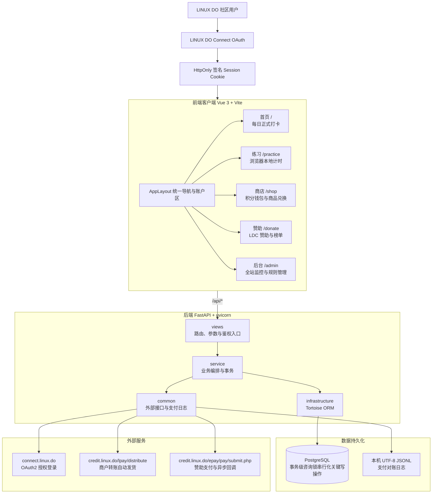

# Kegel 每日提肛打卡 · 项目文档库

欢迎查阅 **Kegel** 系统的完整技术与业务文档。

Kegel 是一个基于 **LINUX DO Connect** 身份认证的每日提肛自律打卡系统。系统集成了分步计时练习、站内积分激励、积分商城（兑换 LDC 自动发货）与独立 LDC 赞助支持平台。

---

## 📚 文档目录索引

| 文档 | 主要内容 | 目标受众 |
|---|---|---|
| [1. 系统架构与设计 (architecture.md)](./architecture.md) | FastAPI 分层、PostgreSQL 事务、Vue 3 前端与安全机制 | 开发者、架构师 |
| [2. 核心业务流程详解 (features.md)](./features.md) | 三组练习计时、积分额度风控、商品兑换自动发货、赞助榜 | 产品、运营、维护者 |
| [3. API 接口规范大全 (api_reference.md)](./api_reference.md) | 全站 RESTful JSON 接口、请求/响应结构体、错误码 | 前端与后端集成人员 |
| [4. 生产部署与运维指南 (deployment.md)](./deployment.md) | 环境变量配置、Nginx/Caddy 反向代理、安全加固与备份 | 运维人员、站长 |

---

## ⚡ 核心设计亮点

1. **前后端分离、职责清晰**：
   - 后端使用 FastAPI、Tortoise ORM 与 PostgreSQL，按 `views → service → infrastructure` 分层。
   - 前端使用 Vue 3、TypeScript、Vite、Naive UI 与 Pinia，开发时由 Vite 代理 `/api`。
2. **强一致性事务**：
   - 积分增减、额度占用、限购核算和赞助到账均在 PostgreSQL 事务中完成。
   - 关键写流程使用事务级咨询锁串行化，避免超领、重复入账与负余额。
3. **安全防线闭环**：
   - 会话 Cookie 使用签名并设置 `HttpOnly`、`SameSite=Lax`，生产环境启用 `Secure`。
   - 外部支付使用 MD5 规范签名及异步通知验签；API 使用统一响应信封。
4. **现代响应式体验**：
   - 前端布局组件统一导航、账户状态和登录退出行为。
   - 练习支持淡入淡出、桌面与移动视口，并保留浏览器本地训练进度。
