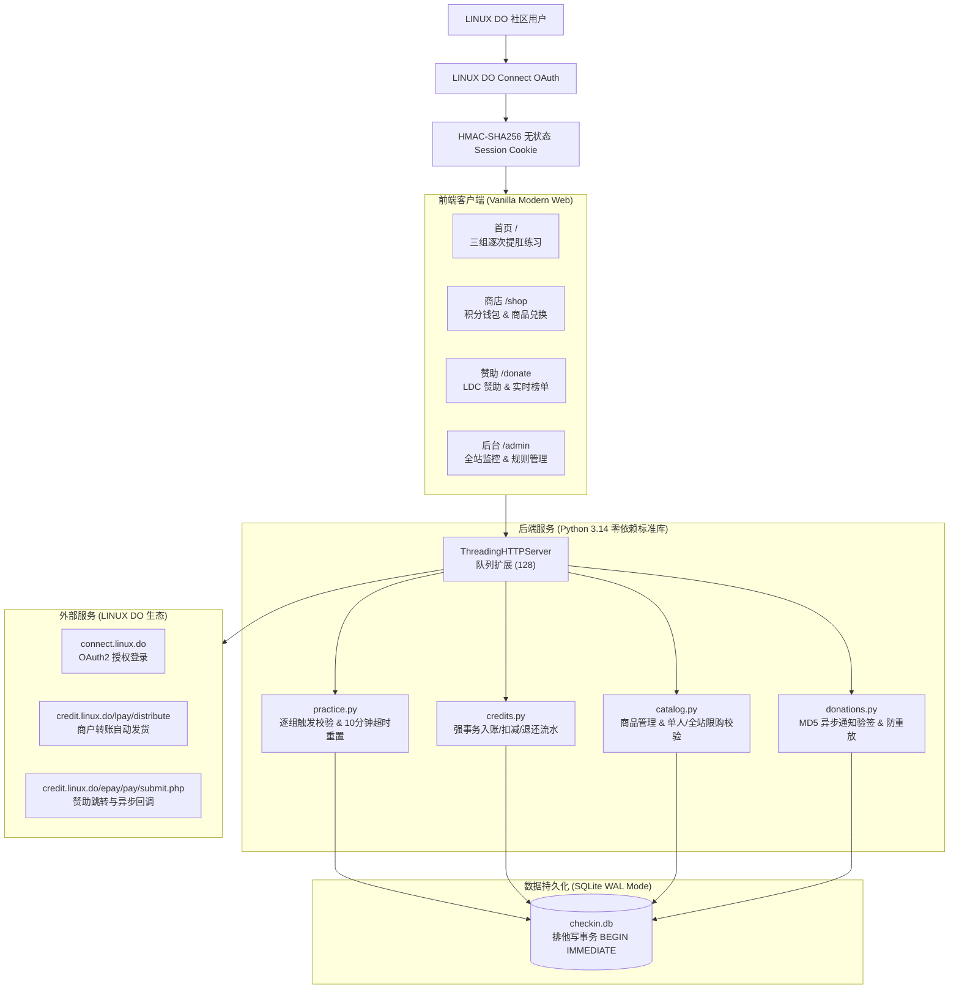

# Kegel 每日提肛打卡 · 项目文档库

欢迎查阅 **Kegel** 系统的完整技术与业务文档。

Kegel 是一个基于 **LINUX DO Connect** 身份认证的每日提肛自律打卡系统。系统集成了分步计时练习、站内积分激励、积分商城（兑换 LDC 自动发货）与独立 LDC 赞助支持平台。

---

## 📚 文档目录索引

| 文档 | 主要内容 | 目标受众 |
|---|---|---|
| [1. 系统架构与设计 (architecture.md)](./architecture.md) | 零依赖架构、SQLite WAL 事务设计、状态机与安全机制 | 开发者、架构师 |
| [2. 核心业务流程详解 (features.md)](./features.md) | 三组练习计时、积分额度风控、商品兑换自动发货、赞助榜 | 产品、运营、维护者 |
| [3. API 接口规范大全 (api_reference.md)](./api_reference.md) | 全站 RESTful JSON 接口、请求/响应结构体、错误码 | 前端与后端集成人员 |
| [4. 生产部署与运维指南 (deployment.md)](./deployment.md) | 环境变量配置、Nginx/Caddy 反向代理、安全加固与备份 | 运维人员、站长 |

---

## ⚡ 核心设计亮点

1. **绝对零外部依赖**：
   - 依赖项仅为 `Python >= 3.14` 标准库（`dependencies = []`），无需 `pip install`，无包版本冲突或供应链安全漏洞。
2. **纯粹的强一致性事务**：
   - 数据库使用 SQLite 开启 **WAL 模式**（读写不互斥）。
   - 所有写操作（积分增减、额度占用、限购核算、赞助到账）均在 `BEGIN IMMEDIATE` 互斥写事务中执行，杜绝超领与负余额。
3. **安全防线全闭环**：
   - 会话 Cookie 采用 HMAC-SHA256 签名，防御时序攻击（`hmac.compare_digest`），打上 `HttpOnly`、`SameSite=Lax` 与 `Secure` 标记。
   - 外部支付使用 MD5 严格升序排序签名及防伪通知核验。
4. **现代极简设计与响应式体验**：
   - 纯净白底、深灰文字与青绿色点缀，全站无背景图与冗余框框。
   - 三组练习带有平滑淡入淡出动效，倒计时结束暂停等待主动点击，完美适配桌面与手机视口。
