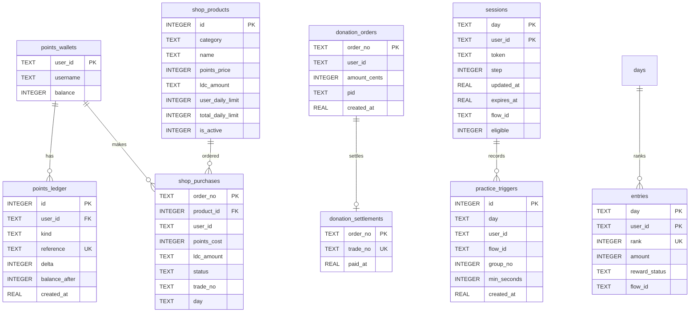

# 系统架构与底层设计

本文档深入解析 **Kegel** 系统的底层架构、技术选型考量、数据模型设计以及安全性机制。

---

## 1. 技术选型与设计哲学

Kegel 遵循 **“正确性优先，删除冗余抽象，杜绝不必要的计算与内存拷贝”** 的工程理念。

```
┌─────────────────────────────────────────────────────────────┐
│                      Client Layer                           │
│     Vanilla Modern JS (ES2022) + CSS Variables + WAAPI      │
└──────────────────────────────┬──────────────────────────────┘
                               │ HTTP / JSON
┌──────────────────────────────▼──────────────────────────────┐
│                      Server Runtime                         │
│            Python 3.14 Standard Library Only                │
│  - http.server.ThreadingHTTPServer (request_queue_size=128) │
│  - hmac + hashlib + secrets (Cryptographic primitives)      │
│  - urllib.request + json (External HTTP Communication)      │
└──────────────────────────────┬──────────────────────────────┘
                               │ In-Process SQLite WAL
┌──────────────────────────────▼──────────────────────────────┐
│                      Database Layer                         │
│            checkin.db (PRAGMA journal_mode = WAL)           │
│           Exclusive Write via BEGIN IMMEDIATE               │
└─────────────────────────────────────────────────────────────┘
```

### 1.1 为什么坚持零外部依赖？
- **零依赖腐蚀**：第三方包存在频繁的版本断代、维护停滞或被供应链攻击投毒的风险。完全基于标准库使系统在 5 到 10 年后依然能够开箱即用。
- **冷启动与轻量化**：Python 3.14 进程冷启动在 50ms 以内，常驻内存占用仅约 20MB。
- **透明可控**：全站没有任何黑盒隐式逻辑，所有状态转换均由原生事务保护。

---

## 2. 数据库设计与持久化模型

数据库采用本地 SQLite，默认文件名为 `checkin.db`。初始化时执行：
```sql
PRAGMA journal_mode = WAL;
PRAGMA foreign_keys = ON;
```
WAL（Write-Ahead Logging）模式使得读操作完全不阻塞写操作，写操作也不阻塞读操作，大幅提升并发吞吐量。

### 2.1 核心数据表结构



### 2.2 数据字典说明

1. **`points_wallets`（站内积分钱包表）**
   - `user_id` (TEXT, PK)：用户在 LINUX DO Connect 的唯一数字 ID。
   - `balance` (INTEGER)：可用积分余额，带有非负校验 `CHECK(balance >= 0)`。
2. **`points_ledger`（积分流水明细表）**
   - 记录每一笔积分变动：入账（`delta > 0`）或消费扣减（`delta < 0`）。
   - `(kind, reference)` 联合唯一键，从数据库底层防御重复入账或扣减。
3. **`shop_products`（商店商品配置表）**
   - 预留品类扩展，当前固定为 `LDC`。
   - `points_price`：兑换扣除积分。
   - `ldc_amount`：自动发货到账的 LDC 金额（两位小数标准字符）。
   - `user_daily_limit` / `total_daily_limit`：单人/全站每日限额控制（`0` 代表不限）。
4. **`shop_purchases`（积分兑换发货订单表）**
   - 记录兑换订单编号、LDC 精确金额与状态（`pending` / `success` / `simulated` / `failed` / `uncertain`）及 Credit 流水号。
   - 每日 LDC 兑换额度按北京时间重置；`pending`、`success`、`simulated`、`uncertain` 占额，`failed` 释放额度。额度汇总以两位小数字符串输出。
5. **`donation_orders` & `donation_settlements`（赞助订单与核验结算表）**
   - 严格分离未支付的赞助意向与已通过 MD5 验签核验的到账记录。
   - 赞助榜仅从 `donation_settlements` 聚合，杜绝未付款上榜。
6. **`practice_triggers`（每组练习打点审计表）**
   - 记录客户端每次点击触发行为的真实服务器到达时间与组次编号，为领奖防作弊提供强审计凭证。

7. **每日兑换配置**
   - 环境变量 `DAILY_LDC_LIMIT` 保存整数 LDC，默认 `800`；`0` 停止兑换但不影响签到积分。修改配置后需重启服务生效，不通过数据库或管理 API 设置。
---

## 3. 并发控制与强一致性事务

为防止高并发请求导致的超卖、超领或负余额问题，后端写操作强制执行：

```python
with db() as connection:
    connection.execute("BEGIN IMMEDIATE")
    # 1. 业务条件严格检查（余额是否足够 / 额度是否已满 / 限购是否超标）
    # 2. 执行扣减或入账
    # 3. 记录流水与状态
    # 事务在 contextmanager 结束时自动 COMMIT，异常自动 ROLLBACK
```

- **`BEGIN IMMEDIATE` 锁语义**：SQLite 在当前写事务开启时立即取得保留锁（Reserved Lock），禁止其他写入者并发写入，所有并发请求按排队序列串行化执行，彻底规避脏读、幻读和丢失更新（Lost Update）。
- **网络连接池队列优化**：标准库 `TCPServer` 默认请求连接队列大小仅为 5，本项目继承 `ThreadingHTTPServer` 并将 `request_queue_size` 扩大为 128，从容应对整点打卡的高并发连接涌入。

---

## 4. 安全防护体系

### 4.1 会话安全与防篡改机制
系统使用类似 JWT 的无状态自研防篡改签名 Token 作为 Cookie：
```
Cookie: linuxdo_session = <Base64Url(Payload)> . <Base64Url(HMAC-SHA256(Payload, APP_SECRET))>
```
- **时序攻击免疫**：验签函数一律采用 `hmac.compare_digest` 恒定时间比对，抵御通过比对耗时推算签名的侧信道攻击。
- **登录门槛与续期**：配置完整 OAuth 凭据后，业务页面在返回 HTML 前检查登录，未登录直接进入授权流程；用户数据和练习接口在处理前验证身份。登录 Cookie 与签名有效期统一为 5 天，有效身份访问页面或业务接口时自动续期；过期凭证不可续期，退出仅清除 Cookie。
- **全方位 Cookie 属性**：
  - `HttpOnly`：禁止一切前端 JS 读取，阻断 XSS 窃取 Cookie。
  - `SameSite=Lax`：禁止第三方站点跨域携带，防护 CSRF 跨站攻击。
  - `Secure`：当 `APP_BASE_URL` 为 HTTPS 时自动追加，强制仅在加密信道传输。
- **CSRF 来源二次校验**：所有 `POST` 接口接收请求时校验 `Origin` 请求头必须与 `APP_BASE_URL` 完全一致。

### 4.2 访问频率异常判定与人工审核
为防止定时脚本全自动化作弊，系统在 `visits` 表中实时追踪身份与散列 IP（SHA-256）：
- 10 分钟内访问达到 20 次；
- 连续 6 次访问呈现高度固定周期（标准差极小）。
触发上述特征时自动将该账号标记为待审核状态（`approved = 0`），其练习将降级为本地模式无法上榜领奖，直到管理员在 `/admin` 后台核验后手动批准放行。
