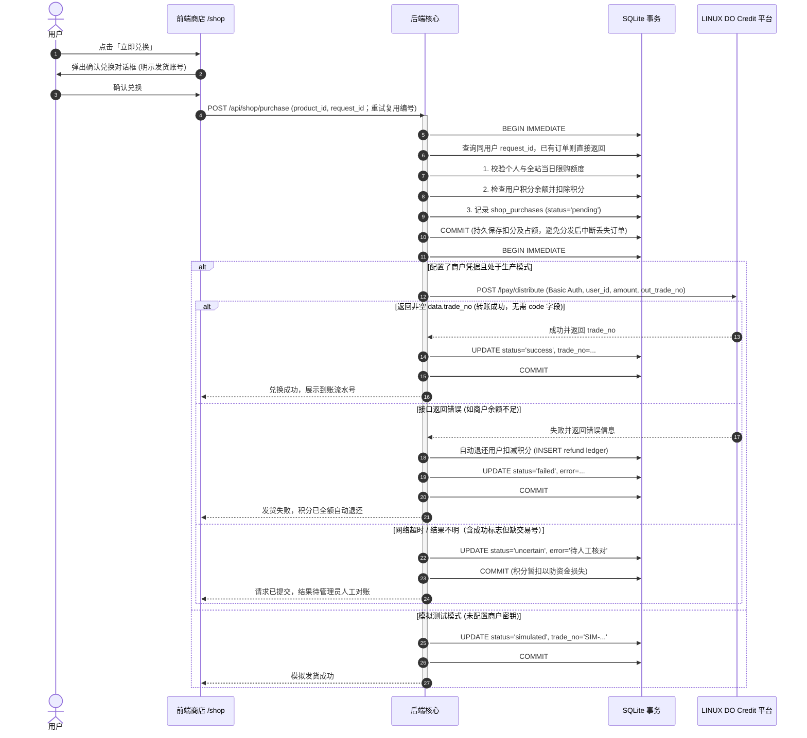

# 核心业务功能与流程详解

本文档详细描述 **Kegel** 系统的核心业务逻辑、状态机流转、风控机制及各页面功能。

---

## 1. 每日提肛练习打卡（首页 `/`）

### 1.1 手动与自主练习

访客打开首页时仅展示初始提示，已有未完成会话也不会自动进入；点击中央练习区域后才进入准备阶段或恢复已有练习。正式打卡、奖励领取和商店等功能仍需登录。手动模式默认三次，由用户点击「开始第 N 次？」开始对应次数；自主模式支持每轮 1–20 次、间隔 2–5 秒，自动继续直到本轮完成，仅显示「第 N 次」，不插入其他中间标题。手动切换先淡出已点击提示再淡入下一次提示，两段各占间隔的一半；自主模式每次先淡入再淡出，两段各占本次间隔的一半，从第一次计时起就执行完整周期。完成后可再开一轮。

首页「你今天提肛了吗？」保持静态显示，只运行每日三次手动打卡，不读取独立练习页保存的模式或次数。进入后先显示「开始第 1 次？」，点击才执行第一次；随后按间隔渐变到下一次提示，倒计时及过渡结束后点击继续。自主练习和其他次数的手动练习仅在独立练习页运行。首页不恢复这些练习；若用户点击继续尚未完成的练习，会转到 `/practice`，保留原进度。

透明度均匀变化。手动模式等待实际淡出结束后换字、再等待淡入完成；自主模式按当前会话凭证和本次时钟驱动完整的「透明→清晰→透明」周期，不排队播放上一次的文字；状态轮询不会重新启动动画或延长本次计时。倒计时提示行保持静止，只更新末尾剩余秒数，不对整行做淡入淡出。

完成卡片和顶部导航提供「提肛练习」入口，打开公开页面 `/practice`。练习卡片仅展示方式、次数和间隔；桌面在侧栏，手机在练习区域下方。所有页面（包含练习页）均通过右下角「设置」管理隐藏默认称呼、自定义称呼、整点/半点提醒及通知授权，练习卡片不再重复展示这些配置。设置跨页同步，但不覆盖练习方式、次数和间隔。首页仅保留每日打卡，独立练习页提供完整练习流程；通知仍需页面保持打开。

练习方式使用「手动／自主」两个圆形单选项。次数标注 1–20 次，超过上限时在输入框下方实时显示红字「最高 20 次」；自主间隔标注 2–5 秒，超出范围或输入非整数时显示对应红字。无效输入保留在输入框，不改回默认值，也不会覆盖已保存的合法配置；开始前需先修正错误，合法后提示自动消失。手动模式禁用自主间隔输入。

服务端保存每次触发时间和本轮配置，最后一次倒计时结束后才允许完成。提前推进或完成返回 `429`；十分钟未继续则本轮失效。刷新可恢复尚未失效的会话。

### 1.2 次数榜与每日奖励

已登录且未处于待审核状态的用户，每完成一轮即累计对应次数，按当天完成总次数排序；打卡未开放时也可累计练习榜。访客不入榜。每日奖励榜仍按开放后完成打卡的先后顺序生成，同一用户每天仅一份奖励。自主模式重复训练不重复发奖；重复完成请求不重复计数。

### 1.3 隐私与提醒设置

设置支持隐藏「提肛」或自定义称呼，并保存于浏览器；URL `?hide_tigang=1` 可直接隐藏，`?exercise_name=运动` 可替换称呼。所有页面的标题、提示及辅助文字同步应用。

提醒可选每整点、每半点或同时开启，由用户点击申请通知权限。需要 HTTPS 或 localhost，页面保持打开才会调度；浏览器休眠恢复后不补发过期提醒，关闭页面后不提供定时推送。

### 1.4 服务端时间校验

每次开始及继续均提交服务端，完成与领取时校验本轮全部触发记录、身份、次数和间隔。记录完整且每次间隔均达标才可结算；修改浏览器计时无法提前完成。后台显示最近 200 次触发时间。自主步骤不会逐次触发高频访问审核。

---

## 2. 站内积分激励与全站每日 LDC 兑换限额

### 2.1 阶梯排名奖励（北京时间每日重置）
系统以 `Asia/Shanghai` 每日零点为新的一天。登录用户在开放后完成本轮所选次数，按先后顺序分配当天唯一打卡名次：
- **第 1 – 10 名**：默认每人获得 `1000` 站内积分；
- **第 11 – 20 名**：默认每人获得 `500` 站内积分；
- **第 21 – 50 名**：默认每人获得 `100` 站内积分；
- **第 51 名起**：记录打卡名次，无积分奖励。
*（上述档位在管理后台支持任意增删改）*

签到积分领取不受 LDC 兑换额度限制。即使每日兑换额度为 `0`，已获得的 1000、500 或 100 站内积分仍可正常领取。

### 2.2 全站每日 LDC 兑换限额（默认 800 LDC）
- **配置与重置**：环境变量 `DAILY_LDC_LIMIT` 接受整数 LDC，默认 `800`，修改后需重启服务生效；额度按北京时间每日零点重置，设为 `0` 会停止兑换，但不影响签到或领取站内积分。
- **精确金额统计**：每笔兑换按商品的 `ldc_amount` 精确金额累计，而不是按订单数或消耗的站内积分统计；额度值统一显示为两位小数字符串。
- **订单状态**：`pending`、`success`、`simulated` 和 `uncertain` 占用额度，`failed` 不占额度并释放原先预占金额。
- **整笔拒绝**：商品的 LDC 金额大于 `quota.remaining` 时不能兑换，不拆分发货。

---

## 3. 商店 (`/shop`) 与积分兑换 LDC 自动发货

### 3.1 商品品类与配置属性
目前商店商品品类为 **LDC 积分发货**，在后台录入时包含如下属性：
- **积分售价**：购买消耗的站内积分（如 500 分）。
- **LDC 数量**：发货到账的 LDC 数量（如 1.00 LDC，必须保留至多两位小数）。
- **单人每日限购数**：每个用户每天最多可兑换的次数（`0` 为不限）。
- **全站每日总限购数**：全平台每天最多可被兑换的总次数（`0` 为不限）。

### 3.2 兑换发货完整事务流程

---

## 4. 独立赞助页面 (`/donate`) 与防伪验签

为保持站内经济体系的纯粹性，**赞助绝对独立，赞助不会增加任何站内积分**。

1. **赞助发起**：
   用户选择或输入赞助金额（如 10.00 LDC），后端生成带签名防伪的订单，通过表单将用户重定向至官方支付网关 `https://credit.linux.do/epay/pay/submit.php`。
2. **异步回调防伪核验 (`/payments/ldc/notify`)**：
   - 官方服务器在用户支付成功后向本站发送 GET 异步通知。
   - 后端对除 `sign`、`sign_type` 外的所有非空参数按 ASCII 字典升序拼接并追加 `Client Secret`，执行 **MD5 验签**。
   - 验签通过后，核实商户 PID、订单号及金额完全相符，在数据库写事务中将交易流水号记录到 `donation_settlements` 表中，返回 HTTP 200 `success`。
3. **公开赞助榜**：
   - 赞助榜只统计 `donation_settlements` 中已结算入账的赞助，按用户累计赞助的 LDC 总额降序展示前 50 名。
   - 任何浏览器手动拼接 URL 参数（如 `?donation=...&paid=1`）均不会使订单上榜，严防客户端伪造假赞助。
