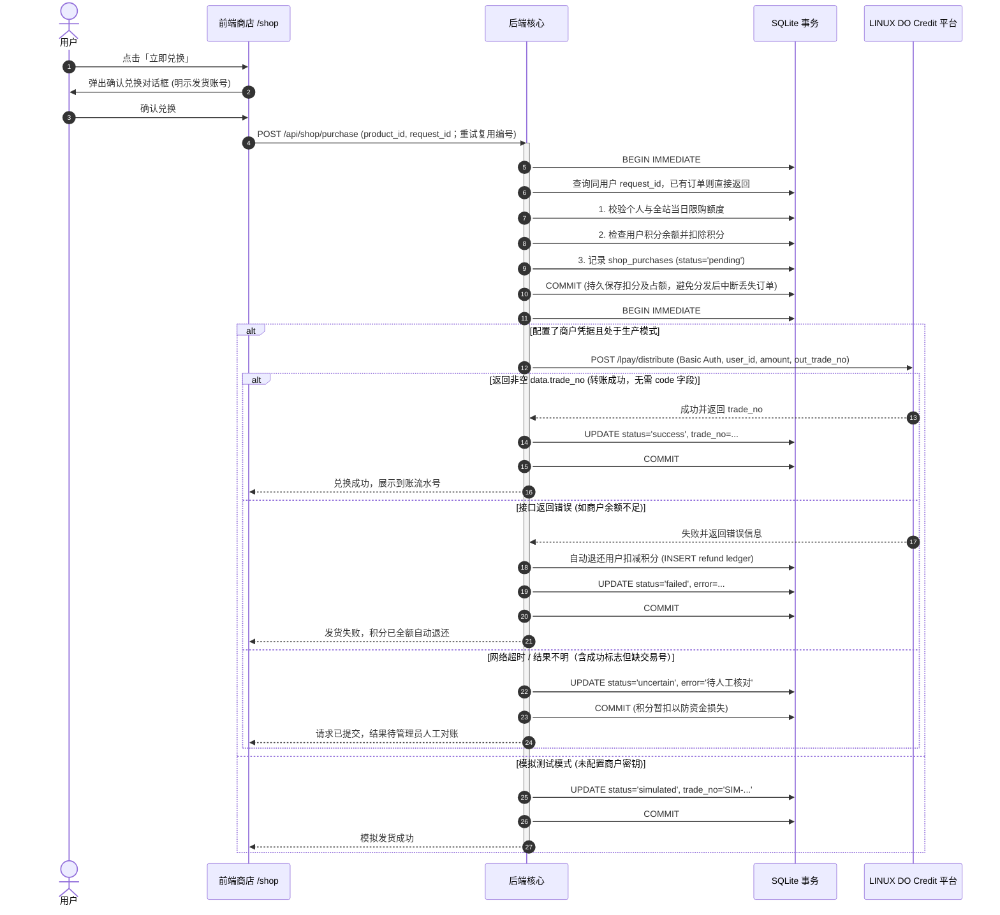

# 核心业务功能与流程详解

本文档详细描述 **Kegel** 系统的核心业务逻辑、状态机流转、风控机制及各页面功能。

首页、练习、商店、赞助和管理页共用 `static/navigation.js` 导航组件，入口固定为「首页、提肛练习、商店、赞助、管理」，首页初始状态也显示导航。组件按当前路径（包括 `.html` 地址）设置唯一高亮和 `aria-current`，统一处理账户状态、登录回跳与退出；各页只传入服务端账户数据，不再维护各自的菜单和账户按钮逻辑。所有页面使用相同的吸顶及窄屏横向滚动样式，显示称呼偏好随导航链接传递。管理后台在顶栏下方布局，不遮挡主导航。

---

## 1. 每日提肛练习打卡（首页 `/`）

### 1.1 手动与自动练习

首页在今日尚未完成打卡时显示初始页，点击页面或按键后进入三次手动打卡准备阶段或恢复已有打卡；今日已完成打卡时直接展示结算页。独立训练在 `/practice` 本地计时，支持手动和自动模式；访客可训练，登录后上传起止时间和次数并参与训练榜。正式打卡、奖励领取和商店等功能仍需登录。

打卡和训练分别保存进度，训练方式、次数和完成状态均不接管首页。起始页点击只进入打卡流程，不自动跳转到训练。进入训练页仅通过首页「提肛练习」按钮或顶部导航；训练完成后仍留在训练页。打卡固定三次手动操作，进入后先显示「开始第 1 次？」，再次点击才记录第一次。独立训练支持 1–20 次，每次 2–10 秒，手动与自动模式均可设置时长。

首页手动打卡等待实际淡出结束后换字、再等待淡入完成。独立训练按本次时钟依次显示「提～、放松、休息」，初始比例为 45% / 40% / 15%。每个阶段独立线性渐变：前 2/3 时间从透明淡入至完全显现，后 1/3 时间淡出至透明；阶段切换按分界时刻进行，不延长计时，重复渲染不重播动画，刷新后从当前阶段进度恢复。时间轴有两个可拖动分界点，按 1% 调整，并显示时间刻度、各阶段比例和秒数。分界点可位于 0% 和 100%，也可重合；占比为 0% 的阶段标注「已取消」，直接跳过其文字和动画，可只保留一个阶段。重合控制器上下错开，仍可分别拖动。「阶段分配」内提供三个文字输入框，每段最多 24 字，留空恢复对应默认文字；自定义文字同步用于主提示、时间轴说明和控制器标签。配置在浏览器保存，从下一轮生效，刷新恢复本轮原文字和比例。自动模式连续进入下一次，手动模式等待点击；倒计时不延长本次时长。

完成卡片和顶部导航提供「提肛练习」入口，打开 `/practice`。训练设置展示方式、次数、每次时长和阶段分配，可收起或展开；下方依次展示「每日训练榜」「训练总榜」「我的训练记录」。每日榜按今日有效上传次数排名，总榜按所有日期的有效上传次数累计，两榜统一使用独立训练记录，过滤相同的待审核记录，各展示前 50 名；同分按最早上传时间、用户 ID 稳定排序。个人明细展示当前账号最近 50 轮的起止时间、次数和方式。首页只保留打卡奖励榜和规则，不展示训练榜。顶部导航滚动时吸顶，可通过「首页」返回，训练不阻止返回。显示和通知设置仍统一在右下角「设置」。页面加载后断网仍可训练，进度与待上传记录保留；恢复网络后须在有效时间内上传，失败时显示原因并提供手动重传。通知仍需页面保持打开。

练习方式使用「手动／自动」两个圆形单选项，首次打开默认选中「自动」，次数 10、每次 3 秒；已保存的配置不会被默认值覆盖。次数标注 1–20 次，超过上限时在输入框下方实时显示红字「最高 20 次」；时长标注 2–10 秒，超出范围或输入非整数时显示对应红字。无效输入保留在输入框，不改回默认值，也不会覆盖已保存的合法配置；开始前需先修正错误，合法后提示自动消失。两种模式均提供「放弃本轮」，只保留已完整完成的次数；当前未做完的一次不计数，零次不上传。重复点击或刷新不会重复累计。

首页打卡由服务端保存触发记录并校验间隔，提前推进或完成返回 `429`。独立训练逐次推进无需请求服务端，完成后一次性上传开始/结束时间、次数、方式和间隔。服务端要求开始时间在一小时内、结束时间在五分钟内、未来偏差不超过 30 秒，总时长至少覆盖次数乘间隔。同一用户跨轮、跨日的区间不得重叠；端点相接允许。同一轮原样重传幂等成功，改内容重传被拒绝。两者超过十分钟未继续时本轮失效，刷新恢复各自有效进度。

### 1.2 次数榜与每日奖励

独立训练上传后按当前登录账号记录，待审核用户不能上传或进入对应日期的训练统计。后端在同一事务内完成查重、重叠检查和入库，防止多个标签页重复累计。每日榜和总榜只累计独立上传记录，不与首页打卡进度、名次或奖励混用；训练不发放积分。旧首页练习榜的 `practice_completions` 表已废弃，升级时删除，不影响打卡凭证和奖励领取。个人明细只向当前账号提供，公开榜单只展示用户名与次数。客户端会绑定待上传记录的账号，切换账号不会自动将原账号的训练转给新账号。旧本地记录没有完整时间信息，不补传。

### 1.3 隐私与提醒设置

设置支持隐藏「提肛」或自定义称呼，并保存于浏览器；URL `?hide_tigang=1` 可直接隐藏，`?exercise_name=运动` 可替换称呼。所有页面的标题、提示及辅助文字同步应用。

提醒可选每整点、每半点或同时开启，由用户点击申请通知权限。需要 HTTPS 或 localhost，页面保持打开才会调度；浏览器休眠恢复后不补发过期提醒，关闭页面后不提供定时推送。

### 1.4 服务端时间校验

每次开始及继续均提交服务端，完成与领取时校验本轮全部触发记录、身份、次数和间隔。记录完整且每次间隔均达标才可结算；修改浏览器计时无法提前完成。后台显示最近 200 次触发时间。自动步骤不会逐次触发高频访问审核。

---

## 2. 站内积分激励与全站每日 LDC 兑换限额

### 2.1 阶梯排名奖励（北京时间每日重置）
系统以 `Asia/Shanghai` 每日零点为新的一天。登录用户在开放后完成本轮所选次数，按先后顺序分配当天唯一打卡名次：
- **第 1 – 10 名**：默认每人获得 `1000` 站内积分；
- **第 11 – 20 名**：默认每人获得 `500` 站内积分；
- **第 21 – 50 名**：默认每人获得 `100` 站内积分；
- **第 51 名起**：记录打卡名次，无积分奖励。
*（上述档位在管理后台支持任意增删改）*

签到积分领取不受 LDC 兑换额度限制。即使每日兑换额度为 `0`，已获得的 1000、500 或 100 站内积分仍可正常领取。

### 2.2 全站每日 LDC 兑换限额（默认 800 LDC）
- **配置与重置**：环境变量 `DAILY_LDC_LIMIT` 接受整数 LDC，默认 `800`，修改后需重启服务生效；额度按北京时间每日零点重置，设为 `0` 会停止兑换，但不影响签到或领取站内积分。
- **精确金额统计**：每笔兑换按商品的 `ldc_amount` 精确金额累计，而不是按订单数或消耗的站内积分统计；额度值统一显示为两位小数字符串。
- **订单状态**：`pending`、`success`、`simulated` 和 `uncertain` 占用额度，`failed` 不占额度并释放原先预占金额。
- **整笔拒绝**：商品的 LDC 金额大于 `quota.remaining` 时不能兑换，不拆分发货。

---

## 3. 商店 (`/shop`) 与积分兑换 LDC 自动发货

### 3.1 商品品类与配置属性
目前商店商品品类为 **LDC 积分发货**，在后台录入时包含如下属性：
- **积分售价**：购买消耗的站内积分（如 500 分）。
- **LDC 数量**：发货到账的 LDC 数量（如 1.00 LDC，必须保留至多两位小数）。
- **单人每日限购数**：每个用户每天最多可兑换的次数（`0` 为不限）。
- **全站每日总限购数**：全平台每天最多可被兑换的总次数（`0` 为不限）。

### 3.2 兑换发货完整事务流程

---

## 4. 独立赞助页面 (`/donate`) 与防伪验签

为保持站内经济体系的纯粹性，**赞助绝对独立，赞助不会增加任何站内积分**。

1. **赞助发起**：
   用户选择或输入赞助金额（如 10.00 LDC），后端生成带签名防伪的订单，通过表单将用户重定向至官方支付网关 `https://credit.linux.do/epay/pay/submit.php`。
2. **异步回调防伪核验 (`/payments/ldc/notify`)**：
   - 官方服务器在用户支付成功后向本站发送 GET 异步通知。
   - 后端对除 `sign`、`sign_type` 外的所有非空参数按 ASCII 字典升序拼接并追加 `Client Secret`，执行 **MD5 验签**。
   - 验签通过后，核实商户 PID、订单号及金额完全相符，在数据库写事务中将交易流水号记录到 `donation_settlements` 表中，返回 HTTP 200 `success`。
3. **公开赞助榜**：
   - 赞助榜只统计 `donation_settlements` 中已结算入账的赞助，按用户累计赞助的 LDC 总额降序展示前 50 名。
   - 任何浏览器手动拼接 URL 参数（如 `?donation=...&paid=1`）均不会使订单上榜，严防客户端伪造假赞助。
